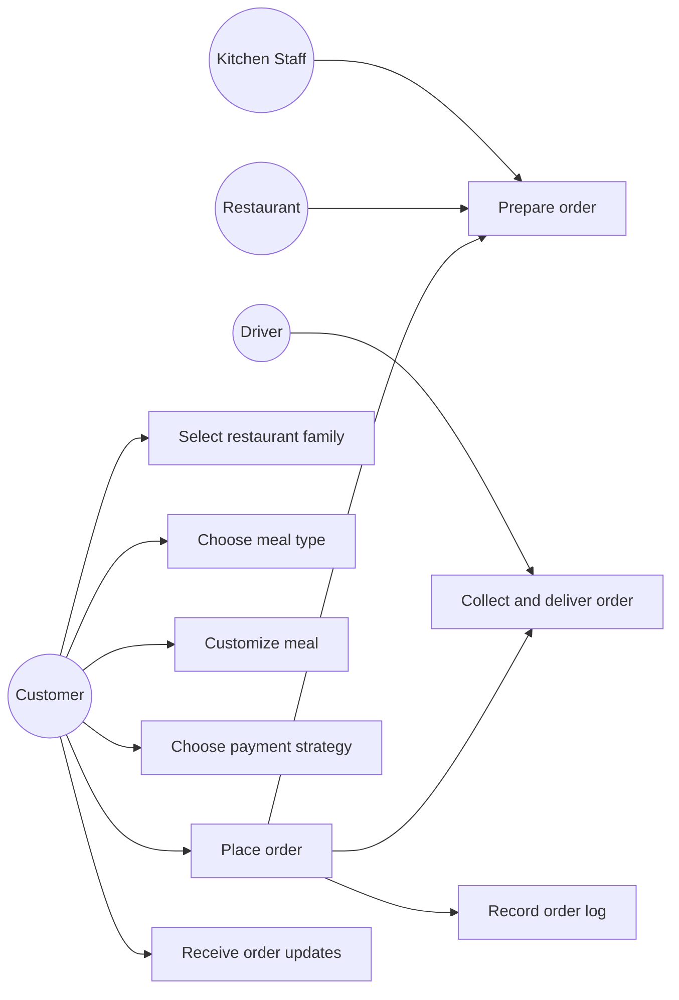

# QuickBite Food Delivery App Report

## Section A: Problem Analysis

QuickBite is a prototype food ordering and delivery application similar to Uber Eats or Mr D. Customers can select a restaurant, browse that restaurant's own menu, customize a meal, choose a payment or pricing method, and receive order progress updates.

Assumptions:

- The prototype uses in-memory order state because the assignment focuses on design pattern implementation rather than persistence.
- Payment processing is simulated and returns a `PaymentResult`.
- Delivery tracking is simulated through observer notifications.
- One active order is stored for demo purposes.

## Section B: Design Decisions

Factory Method is used by restaurant-specific meal factories to create meals without making the controller instantiate each meal directly. Each restaurant has its own menu, so QuickBite Fast Food, Urban Table Premium, and GreenBowl Healthy do not share the same meals.

Abstract Factory is used by `RestaurantFactory` and its concrete factories to group related restaurant outputs: restaurant name, packaging type, branding, menu positioning, and meal creation.

Decorator is used by `MealDecorator` subclasses so meal customizations can be stacked dynamically. Each menu item defines which customizations make sense for that meal, and each selected decorator updates the meal description and price without modifying the original meal classes.

Strategy is used by `IPaymentStrategy` so payment and pricing behavior can be changed at runtime. Credit card, EFT, PayFast, promo, loyalty, and surge delivery pricing all share the same interface.

Observer is used by `IOrderObserver` so multiple stakeholders can react to order status changes. The order does not need to know how each stakeholder handles a notification.

Singleton is used by `OrderLogger` to provide one shared application logger for order and payment events during the demo.

The architecture keeps the MVC controller as the workflow coordinator while the pattern classes handle domain behavior. Runtime object creation is centralized in provider/factory classes, so the controller requests objects by selected keys rather than directly instantiating every concrete class. This improves loose coupling and makes the app easier to extend.

## Section C: UML Diagrams

### Class Diagram

```mermaid
classDiagram
    class Order {
        +Meal Meal
        +RestaurantFactory RestaurantFactory
        +IPaymentStrategy PaymentStrategy
        +PaymentResult PaymentResult
        +string Status
        +Attach(IOrderObserver)
        +Notify(string)
        +Checkout()
    }

    class Meal {
        <<abstract>>
        +string Name
        +decimal BasePrice
        +GetDescription() string
        +GetPrice() decimal
    }

    Meal <|-- BurgerMeal
    Meal <|-- PizzaMeal
    Meal <|-- PastaMeal
    Meal <|-- DrinkMeal
    Meal <|-- DessertMeal
    Meal <|-- MealDecorator
    MealDecorator <|-- ExtraCheeseDecorator
    MealDecorator <|-- BaconDecorator
    MealDecorator <|-- DoublePattyDecorator
    MealDecorator <|-- LargePortionDecorator
    MealDecorator <|-- ExtraSauceDecorator
    MealDecorator <|-- GlutenFreeDecorator

    class MealFactory {
        <<abstract>>
        +CreateMeal(string) Meal
        +GetMenuItems() IReadOnlyList~MealOption~
    }
    MealFactory <|-- FastFoodMealFactory
    MealFactory <|-- PremiumMealFactory
    MealFactory <|-- HealthyMealFactory
    MealFactory ..> Meal

    class RestaurantFactory {
        <<abstract>>
        +CreateMeal(string) Meal
        +GetMenuItems() IReadOnlyList~MealOption~
        +GetRestaurantName() string
        +GetPackagingType() string
        +GetBranding() string
        +GetMenuPositioning() string
    }
    RestaurantFactory <|-- FastFoodRestaurantFactory
    RestaurantFactory <|-- PremiumRestaurantFactory
    RestaurantFactory <|-- HealthyFoodRestaurantFactory

    class IPaymentStrategy {
        <<interface>>
        +ProcessPayment(decimal) PaymentResult
        +GetPaymentDetails() string
    }
    IPaymentStrategy <|.. CreditCardStrategy
    IPaymentStrategy <|.. EftStrategy
    IPaymentStrategy <|.. PayFastStrategy
    IPaymentStrategy <|.. PromoCodeStrategy
    IPaymentStrategy <|.. LoyaltyDiscountStrategy
    IPaymentStrategy <|.. SurgeDeliveryFeeStrategy

    class IOrderObserver {
        <<interface>>
        +Update(Order, string) OrderNotification
    }
    IOrderObserver <|.. CustomerNotifier
    IOrderObserver <|.. RestaurantNotifier
    IOrderObserver <|.. DriverNotifier
    IOrderObserver <|.. KitchenStaffNotifier

    class OrderLogger {
        -OrderLogger()
        +Instance OrderLogger
        +Log(string)
        +GetLogs() IReadOnlyList~string~
    }

    Order o-- Meal
    Order o-- RestaurantFactory
    Order o-- IPaymentStrategy
    Order o-- IOrderObserver
    Order ..> OrderLogger

    class RestaurantFactoryProvider {
        +Create(string) RestaurantFactory
        +GetMenus() IReadOnlyDictionary
    }

    class MealCustomizationFactory {
        +ApplyCustomizations(Meal, IEnumerable, IEnumerable) Meal
    }

    class PaymentStrategyFactory {
        +Create(string, string) IPaymentStrategy
    }

    class OrderObserverProvider {
        +CreateDefaultObservers() IReadOnlyList~IOrderObserver~
    }

    RestaurantFactoryProvider ..> RestaurantFactory
    MealCustomizationFactory ..> MealDecorator
    PaymentStrategyFactory ..> IPaymentStrategy
    OrderObserverProvider ..> IOrderObserver
```

### Use Case Diagram

## Section D: Reflection

Team collaboration can be split by responsibility: one member handles meal creation and restaurant families, one handles decorators and pricing strategies, one handles observer notifications and logging, and another handles MVC views/documentation.

Challenges encountered:

- Keeping each pattern visible without overcomplicating a small prototype.
- Showing observer output in the browser instead of only writing to the console.
- Keeping UI choices aligned with the exact assignment requirement list while still making restaurant menus and meal customizations realistic.

Lessons learned:

- Design patterns are most useful when each class has a narrow responsibility.
- MVC controllers should coordinate workflows but avoid owning all business logic.
- Dynamic object creation should be delegated to factories/providers so concrete classes are not scattered across UI workflow code.
- UML diagrams help confirm that the implementation actually matches the intended architecture.
